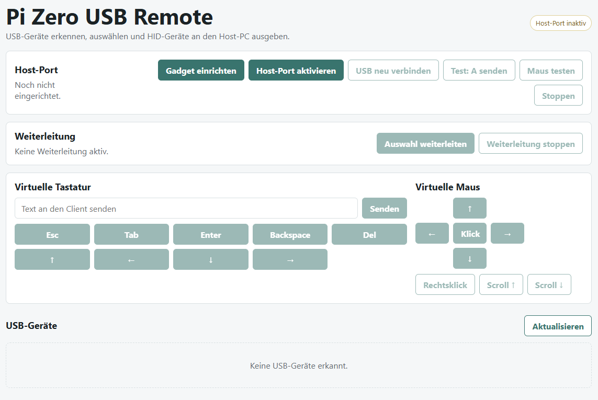

# Pi Zero HID Bridge

Pi Zero HID Bridge turns a Raspberry Pi Zero 2 W into a small network-controlled USB HID bridge. The Pi exposes a virtual USB keyboard and mouse to a connected host over its USB/OTG port, while input devices can be selected and forwarded from a web interface.

The project was built for headless client control: plug the Pi into the client machine as a USB device, access the Pi over Wi-Fi, then forward keyboard and mouse input or use the built-in virtual keyboard and mouse controls.



*Screenshot from the earlier German-language interface. The current interface is in English.*

## What It Can Do

- Detect attached USB devices from Linux sysfs.
- Hide internal Raspberry Pi USB controllers and root hubs.
- Show detected devices and HID input channels in a web interface.
- Select forwardable keyboard and mouse devices.
- Forward Linux input events to `/dev/hidg0` and `/dev/hidg1`.
- Provide a virtual keyboard and virtual mouse for direct output testing.
- Show USB gadget state, including whether the client is connected or only bound.
- Reconnect the USB gadget from the web interface.
- Provide a diagnostic script for `dwc2`, configfs, UDC, VBUS, and HID gadget state.

## Important Hardware Notes

A Raspberry Pi Zero 2 W cannot transparently pass arbitrary USB devices through the same USB/OTG port. That port is either acting as a USB host or as a USB device.

This project solves the practical remote-control case by exposing a USB HID keyboard and mouse gadget to the client. Keyboard and mouse input can come from Linux input devices on the Pi, including devices made available over the network by VirtualHere.

For the Pi Zero 2 W:

- Connect the client machine to the Pi `USB`/OTG data port, not the `PWR IN` port.
- Use a real USB data cable.
- Power the Pi in a way that does not prevent the OTG port from being used as a USB device.
- If the web interface shows `not attached`, the client has not electrically accepted or enumerated the USB gadget yet.

## Installation On The Pi

Copy this project to the Raspberry Pi, then run:

```bash
sudo bash install/setup-pi.sh
sudo reboot
```

After reboot, open:

```text
http://<pi-ip>:8080
```

## Updating Wi-Fi From bootfs

The installer also enables a boot-time Wi-Fi updater. It copies `bootfs/update-wifi.sh` to the Raspberry Pi boot partition and installs a systemd service that runs it early during boot.

To change Wi-Fi later, create a file named `wifi-credentials.txt` on the bootfs partition next to `update-wifi.sh`:

```text
SSID=Your WiFi Name
PASSWORD=Your WiFi Password
COUNTRY=DE
HIDDEN=false
```

Then reboot the Pi. During boot, the updater:

1. Reads `wifi-credentials.txt` from bootfs.
2. Applies the Wi-Fi settings using NetworkManager when available, otherwise `wpa_supplicant`.
3. Deletes `wifi-credentials.txt` after reading it.
4. Logs to `/var/log/bootfs-wifi-update.log`.

The file can also use `WIFI_SSID`, `WIFI_PASSWORD`, `WIFI_COUNTRY`, and `WIFI_HIDDEN` as key names. Quoted values are supported. Deleting the input file does not remove the saved Wi-Fi profile that the Pi needs to reconnect.

### Headless Setup Using Only The SD Card

`config.txt` configures the Raspberry Pi firmware and cannot launch shell scripts. On Raspberry Pi OS, use `cmdline.txt` to launch a one-time setup instead. This works while the USB port stays in OTG peripheral mode and requires neither a keyboard nor a working Wi-Fi connection.

If the Wi-Fi updater was already installed by `setup-pi.sh`, simply place `wifi-credentials.txt` on bootfs and reboot. No boot configuration changes are needed.

If it has not been installed:

1. Power off the Pi and insert its SD card into your PC.
2. Open the visible `bootfs` partition and back up its `cmdline.txt`.
3. Copy `bootfs/bootstrap-wifi.sh` and `bootfs/update-wifi.sh` from this project into the root of that partition. Keep the scripts' Unix (LF) line endings.
4. Create `wifi-credentials.txt` there using the example above. Use a 2.4 GHz Wi-Fi network for the Pi Zero 2 W.
5. Append the following to the **existing single line** in `cmdline.txt`, separated from the existing text by a space:

   ```text
   systemd.run=/boot/firmware/bootstrap-wifi.sh systemd.run_success_action=reboot systemd.run_failure_action=none systemd.unit=kernel-command-line.target
   ```

6. Safely eject the SD card, put it back into the Pi, and power it on. Allow a few minutes for the setup boot, automatic reboot, and Wi-Fi connection.

Your previously shown Raspberry Pi OS uses `/boot/firmware`. On older installations where bootfs is mounted at `/boot`, use `systemd.run=/boot/bootstrap-wifi.sh` instead. The path is the location **on the Pi**, not the SD card's Windows drive letter.

Keep all existing options, including `root=`, `modules-load=dwc2,libcomposite`, and any OTG settings. If `cmdline.txt` already contains `systemd.run=` or `systemd.unit=`, finish that setup before adding these bootstrap options.

The setup boot installs and enables the updater service, removes only the added bootstrap options from `cmdline.txt`, and reboots. The next normal boot applies the Wi-Fi settings and deletes `wifi-credentials.txt`. For future password changes, only add a new credentials file and reboot again.

If setup fails before removing the bootstrap options, it will stay at the setup target. Power off, open the SD card on your PC, and restore the backed-up `cmdline.txt` to return to normal startup.

## Usage

1. Connect the Pi `USB`/OTG data port to the target client.
2. Open the web interface over the Pi network address.
3. Confirm the host status shows `Client connected`.
4. Use `Test: send A` or the virtual keyboard to verify output.
5. Select a detected keyboard or mouse device.
6. Click `Forward selection`.

Composite HID receivers often expose several input channels, such as keyboard, mouse, media keys, and system controls. The interface shows those channels and forwards only channels classified as keyboard or mouse input.

## Manual Start

```bash
sudo python3 -m pizero_usb_agent --host 0.0.0.0 --port 8080
```

## Service Commands

```bash
sudo systemctl status pizero-usb-agent
sudo systemctl restart pizero-usb-agent
sudo journalctl -u pizero-usb-agent -f
```

## Diagnostics

If the web interface reports that no USB Device Controller was found, or the host status stays at `not attached`, run:

```bash
sudo bash install/diagnose-pi.sh
```

On a correctly configured Pi Zero 2 W, `/sys/class/udc` should contain at least one controller such as `3f980000.usb`.

Useful states:

- `configured`: the client has enumerated the HID gadget and input should work.
- `not attached`: the gadget is bound on the Pi, but the client has not accepted the USB connection.
- no UDC entry: `dwc2` is not active in peripheral mode.

If `not attached` persists, check the client USB port, the cable, the Pi OTG port, client power state, and whether the client port provides VBUS. Some TVs and embedded clients accept HID gadgets only on specific USB ports.

## Project Layout

```text
pizero_usb_agent/   Python agent, USB detection, HID gadget setup, forwarding
web/                Browser interface
install/            Pi setup, systemd service, diagnostic helper
bootfs/             Headless Wi-Fi bootstrap, updater, credentials template
```
